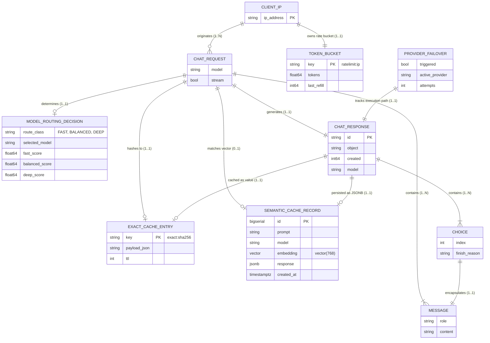
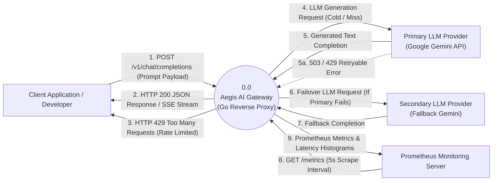
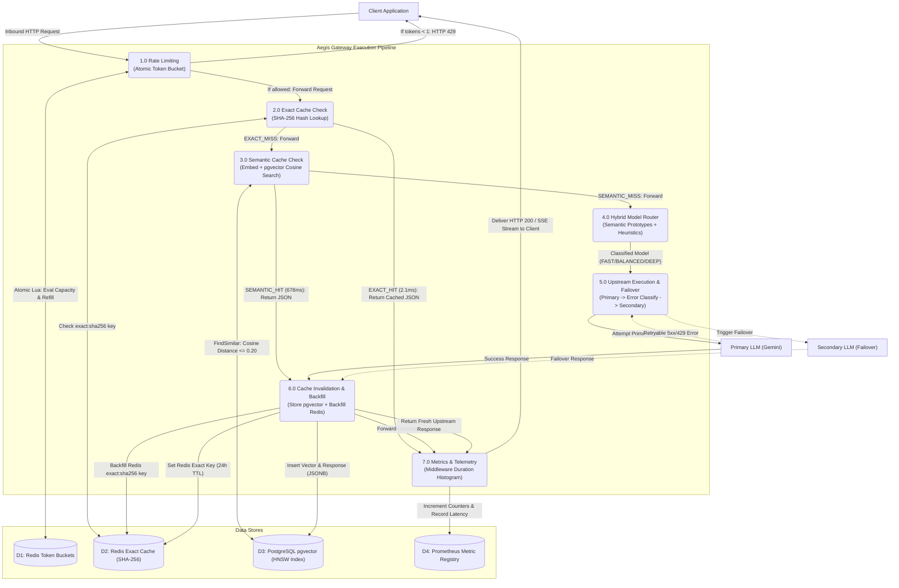

# Aegis — System Design, Architecture & Entity Specifications

A complete granular reference of the **Aegis AI Gateway** architecture designed for backend engineering and distributed systems interview preparation.

---

## 1. Entity & Attribute Catalog (Isolated Entities)

Every core domain object, database table, cache payload, and in-memory data structure used across Aegis:

```mermaid
classDiagram
    class ChatRequest {
        +string model
        +Message[] messages
        +bool stream
    }

    class Message {
        +string role
        +string content
    }

    class ChatResponse {
        +string id
        +string object
        +int64 created
        +string model
        +Choice[] choices
    }

    class Choice {
        +int index
        +Message message
        +string finish_reason
    }

    class ExactCacheEntry_Redis {
        +string key "exact:sha256(canonical_payload)"
        +string value "json(ChatResponse)"
        +int ttl_seconds "86400 (24h)"
    }

    class SemanticCacheRecord_PostgreSQL {
        +int64 id "PK (BIGSERIAL)"
        +string prompt "TEXT"
        +string model "VARCHAR(100)"
        +vector_768 embedding "HNSW Cosine Index"
        +jsonb response "ChatResponse JSON"
        +timestamptz created_at "TIMESTAMPTZ"
    }

    class TokenBucketRecord_Redis {
        +string key "ratelimit:client_ip"
        +float64 tokens
        +int64 last_refill_timestamp
    }

    class ModelRoutingDecision {
        +string class "FAST | BALANCED | DEEP"
        +string selected_model
        +map semantic_scores
        +map heuristic_scores
        +map final_scores
        +string reason
    }

    class FailoverTrackingInfo {
        +bool triggered
        +error primary_error
        +int attempt_count
        +string active_provider "primary | secondary"
    }

    class PrometheusMetricEntry {
        +string metric_name
        +map labels "route, method, status, cache, layer"
        +float64 value
        +float64 duration_bucket
    }
```

---

## 2. Entity-Relationship (ER) Diagram

Data model relationships, foreign keys, cardinality mappings, and entity associations:

---

## 3. Data Flow Diagram (DFD) — Level 0: Context Diagram

System-level view treating Aegis as a single process with external boundaries:

---

## 4. Data Flow Diagram (DFD) — Level 1: Subsystem Decomposition

Granular data flow across internal gateway components and physical persistence stores:

---

## 5. System Design Interview Cheatsheet

### A. The Two-Tier Caching Rationale
* **Layer 1: Redis Exact Cache**
  * Time Complexity: $\mathcal{O}(1)$.
  * Latency: **~1.6–2.1 ms**.
  * Throughput: **1,417+ req/s** sustained across 100 concurrent VUs.
  * Handles identical queries with zero embedding or GPU cost.
* **Layer 2: PostgreSQL `pgvector` Semantic Cache**
  * Time Complexity: $\mathcal{O}(\log N)$ via HNSW vector index.
  * Latency: **~678 ms** (vs. 9,110 ms cold upstream, yielding a **92.55% latency reduction**).
  * Catches paraphrased sentences, typos, and semantic equivalents.
* **The Backfill Optimization**:
  * On a semantic hit, Aegis automatically backfills Redis exact cache for that specific paraphrase.
  * The second time that paraphrase is called, latency drops from **678 ms $\rightarrow$ 2.1 ms** (a **322× acceleration**).

### B. Distributed Token Bucket via Redis Lua
* **Problem**: In distributed systems, separate read-modify-write calls cause race conditions under high concurrency (Check-Then-Act anti-pattern).
* **Solution**: Executing the token bucket calculation inside an atomic Redis Lua script ensures zero lock contention.
* **Empirical Validation**: Sustained **154,378 requests at 7,525.8 req/s** with zero 5xx server crashes and 2.07 ms rejection latency.

### C. The Real Latency Bottleneck: Vector DB vs. Cloud Embedding
* In our benchmarks, we instrumented `X-Vector-Duration-Ms` and `X-Embedding-Duration-Ms`:
  * Local PostgreSQL `pgvector` HNSW search completed in **1.01 ms**.
  * The Google Gemini Cloud embedding network round-trip took **684.54 ms**.
  * **Interview Takeaway**: The vector database is **not** the bottleneck (it accounts for $<0.2\%$ of retrieval time). The external HTTPS call to Google dominates. In ultra-low-latency setups, hosting an in-cluster embedding container (ONNX / TEI) drops semantic retrieval under 15 ms.

### D. Production Traffic Reality (Mixed Traffic Test)
* In real-world production traffic (64% exact hits, 25% semantic hits, 11% cold misses):
  * **Overall Cache Hit Ratio**: **89.01%** (cutting upstream LLM token costs by ~89%).
  * **System Median (P50) Latency**: **1.57 ms** (even with 11% of requests taking 15s+ upstream, 50% of all users experience sub-2ms response times).
